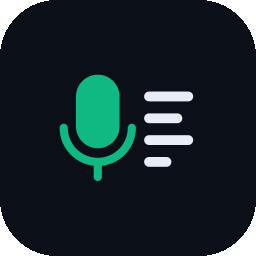
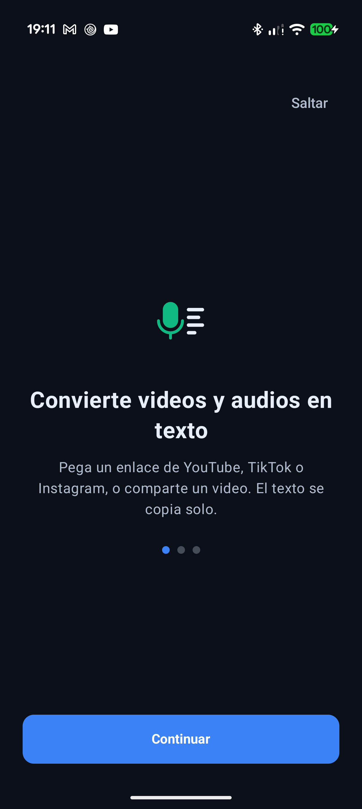
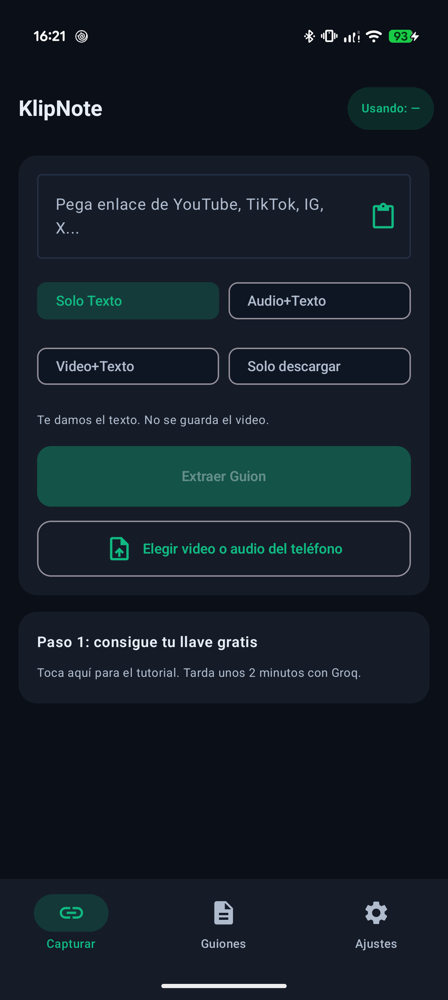
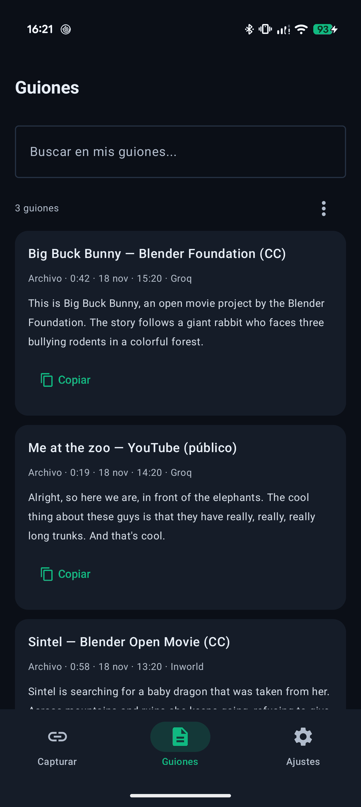
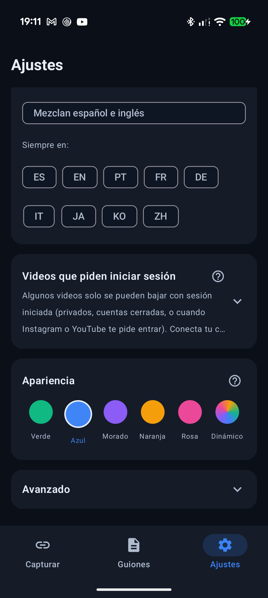

<a href="README.md">🇪🇸 Español</a> · 🇺🇸 <strong>English</strong>

  

<h1 align="center">🎙️ KlipNote</h1>

<strong>Turn videos and audio into text. Free, on your Android.</strong>

  Paste a link, share a video, or pick a file. 
  KlipNote transcribes using free credits from several services (your own keys) 
  and leaves the text ready to paste into any AI.

  
  
  

  
  
  
  

---

## ✨ Why KlipNote?

Transcription usually costs money or hits a single quota that runs out fast.

KlipNote uses **your own API keys** for services that **give free credits or minutes**. It tries them in order (Groq → Inworld → AssemblyAI → Deepgram). When one is out of credit or rate-limited, it moves on.

We don’t promise “free forever”: each company sets its own offers and **they can change**. The app is free; transcription cost depends on those gifts and on **not adding a credit card** there.

---

## 📲 Download

**[→ Download the latest APK](https://github.com/gabrieldave/KlipNote/releases/latest)**

**Requirements:** Android 8.0+ · **arm64** CPU (most phones from 2018 onward).

1. On Releases, download the **`.apk`** file (not “Source code”).
2. Open it on your phone. Allow installs from unknown sources if Android asks.
3. To **update**, install the new APK over the old one — keys and transcripts should stay.

---

## 🚀 How it works

1. **Install** KlipNote from [Releases](https://github.com/gabrieldave/KlipNote/releases/latest).
2. Open the app: the **onboarding** walks you through getting a free key (Groq is recommended; a few minutes).
3. Paste a YouTube, TikTok, Instagram, Facebook, or X link, **or** share a video from Gallery/WhatsApp, **or** pick a local file.
4. Tap **Extract transcript**. The text is **copied automatically** and saved under **Transcripts**.

One free key is enough to start. Add more anytime under **Settings → My keys**.

---

## 💸 The $0 rule

> [!IMPORTANT]
> **Do not add a credit card** on Groq, Inworld, AssemblyAI, or Deepgram.  
> If you do and the free grant ends, the provider may charge you — the app cannot stop that.  
> The **$0 mode** switch (on by default) only blocks the paid engine at the end of the list.

---

## 📖 Guides

Guides are written in **Spanish** (main audience). Same topics:

| Guide | About |
|---|---|
| [Free keys](docs/llaves-gratis.md) | Step-by-step for each provider |
| [FAQ](docs/preguntas-frecuentes.md) | Safety, Play Store, broken sites… |
| [Contribute offers](docs/contribuir-ofertas.md) | Update `config/stt-router.json` without coding |

Index: **[docs/README.md](docs/README.md)**

---

## 🔧 Features

**Transcription**
- Automatic mode: Groq → Inworld → AssemblyAI → Deepgram (paid only if you allow it)
- Four modes: Text only · Audio+text · Video+text · Download only
- Compressed audio so long videos can still be transcribed
- Notification when a job finishes
- Transcript history with search

**Audio / video sources**
- Links from YouTube, TikTok, Instagram, Facebook, and X
- Share from Gallery, Files, WhatsApp, etc.
- Local files
- Download engine (yt-dlp) that **updates itself**

**Savings & control**
- Usage meters (live or estimated, depending on the provider)
- $0 mode to avoid the paid engine
- Offers updatable via remote config (`config/stt-router.json`)

**Privacy & security**
- Keys encrypted on device
- No first-party server or usage analytics
- Site logins only when a video requires them (cookies stay on device)

**Personalization**
- Color themes
- First-run onboarding
- Language detection / forced language for speech

---

## 🔒 Privacy

- Keys are encrypted with the Android Keystore and stay on your phone except when calling the provider you chose.
- Transcripts, cookies, and settings are **local**.
- The only file the app may fetch from this repo is [`config/stt-router.json`](config/stt-router.json). It does not send your data to KlipNote.

---

## ❓ New to GitHub?

1. Open **[Releases](https://github.com/gabrieldave/KlipNote/releases/latest)**.
2. Under **Assets**, tap the file ending in **`.apk`**.
3. Open it on Android and tap **Install**.
4. If asked, allow installs from unknown sources for the app that downloaded the file.

Do not install the “Source code” ZIPs — those are the project source, not the app.

---

## 📙 Contributing

Contributions are welcome:

- **Issues** for bugs or ideas
- **Pull Requests** for offers (`config/stt-router.json`) and code
- Changes to **`.github/workflows`** are reviewed carefully — ask first
- Local build: `./gradlew assembleDebug` (Android SDK required; copy `local.properties.example`)
- If you use an AI assistant, follow [`AGENTS.md`](AGENTS.md) as well

---

## ❗ About / Credits

Maintainer: **[gabrieldave](https://github.com/gabrieldave)**.

**Thanks to**
- [yt-dlp](https://github.com/yt-dlp/yt-dlp) — download engine
- [youtubedl-android](https://github.com/yausername/youtubedl-android) — yt-dlp on Android (junkfood02 fork)
- [Seal](https://github.com/JunkFood02/Seal) — reference app for download ideas and pieces

KlipNote is a **transcription tool**. Respect each platform’s terms and the copyright of anything you download or transcribe. Not affiliated with Groq, Inworld, AssemblyAI, Deepgram, YouTube, or other brands mentioned.

---

## 📜 License

[GNU General Public License v3.0](LICENSE) (GPL-3.0).
