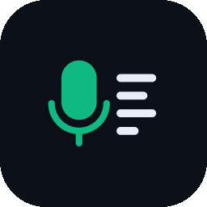
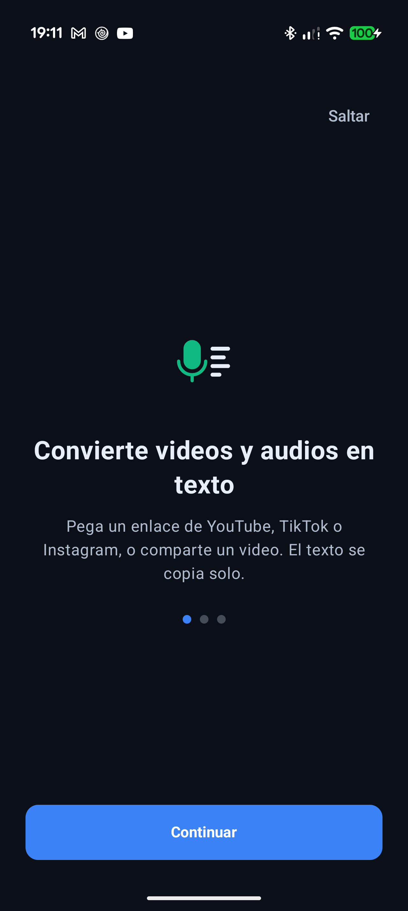
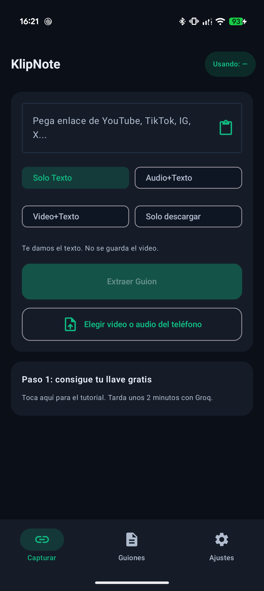
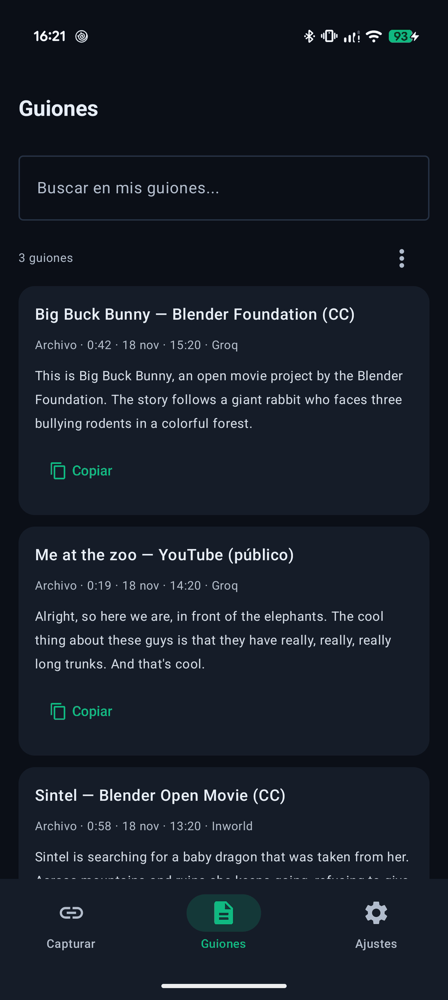
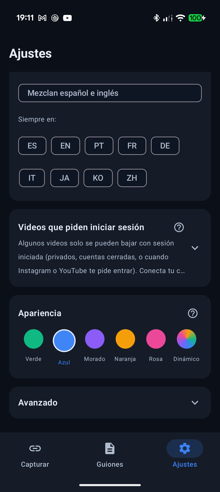

🇪🇸 <strong>Español</strong> · <a href="README.en.md">🇺🇸 English</a>

  

<h1 align="center">🎙️ KlipNote</h1>

<strong>Convierte videos y audios en texto. Gratis, en tu Android.</strong>

  Pega un enlace, comparte un video o elige un archivo. 
  KlipNote transcribe con créditos gratis de varios servicios (tus propias llaves) 
  y deja el texto listo para pegarlo en cualquier IA.

  
  
  

  
  
  
  

---

## ✨ ¿Por qué KlipNote?

Transcribir suele costar dinero o tener un solo límite que se agota rápido.

KlipNote usa **tus propias llaves** de servicios que **regalan créditos o minutos**. Prueba uno tras otro en automático (Groq → Inworld → AssemblyAI → Deepgram). Cuando uno se queda sin saldo o toca el tope, pasa al siguiente.

No prometemos «gratis para siempre»: las ofertas las pone cada empresa y **pueden cambiar**. La app es gratis; el costo de la transcripción depende de esos regalos y de que **no registres tarjeta** ahí.

---

## 📲 Descargar

**[→ Descargar el APK más reciente](https://github.com/gabrieldave/KlipNote/releases/latest)**

**Requisitos:** Android 8.0 o superior · CPU **arm64** (la mayoría de móviles de 2018 en adelante).

1. En Releases, baja el archivo que termina en **`.apk`** (no los «Source code»).
2. Ábrelo en el teléfono. Si Android pide permiso, permite instalar apps de orígenes desconocidos.
3. Para **actualizar**, instala el APK nuevo encima: no deberías perder llaves ni guiones.

Versión actual (Latest): **v1.6.0**.

---

## 🚀 Cómo funciona

1. **Instala** KlipNote desde [Releases](https://github.com/gabrieldave/KlipNote/releases/latest).
2. Abre la app: el **asistente** te guía para sacar una llave gratis (recomendamos Groq; tarda unos minutos).
3. Pega un enlace de YouTube, TikTok, Instagram, Facebook o X, **o** comparte un video desde Galería/WhatsApp, **o** elige un archivo del teléfono.
4. Pulsa **Extraer Guion**. El texto se **copia solo** al portapapeles y queda en **Guiones**.

Con una sola llave gratis ya puedes empezar. En **Ajustes → Mis llaves** puedes añadir más cuando quieras.

---

## 💸 La regla para gastar $0

> [!IMPORTANT]
> **No registres tarjeta** en Groq, Inworld, AssemblyAI ni Deepgram.  
> Si pones tarjeta y se acaba el regalo, el proveedor puede cobrarte y la app no puede impedirlo.  
> El interruptor **Modo $0** (activado por defecto) solo evita el motor de **pago** al final de la lista.

---

## 📖 Guías

| Guía | Contenido |
|---|---|
| [Llaves gratis](docs/llaves-gratis.md) | Paso a paso para cada servicio |
| [Preguntas frecuentes](docs/preguntas-frecuentes.md) | Seguridad, Play Store, sitios que fallan… |
| [Contribuir ofertas](docs/contribuir-ofertas.md) | Actualizar `config/stt-router.json` sin programar |

Índice: **[docs/README.md](docs/README.md)**

---

## 🔧 Funciones

**Transcripción**
- Modo Automático: Groq → Inworld → AssemblyAI → Deepgram (y pago solo si lo permites)
- Cuatro modos: Solo texto · Audio+texto · Video+texto · Solo descargar
- Audio comprimido para poder transcribir videos largos
- Aviso y notificación al terminar
- Historial de guiones con búsqueda

**Fuentes de audio y video**
- Enlaces de YouTube, TikTok, Instagram, Facebook y X
- Compartir desde Galería, Archivos, WhatsApp, etc.
- Archivos locales del teléfono
- Motor de descargas (yt-dlp) que **se actualiza solo**

**Ahorro y control**
- Medidores de consumo (dato real o estimado, según el servicio)
- Modo $0 para no usar el motor de pago
- Ofertas actualizables por config remota (`config/stt-router.json`)

**Privacidad y seguridad**
- Llaves cifradas en el teléfono
- Sin servidor propio ni recolección de datos de uso
- Videos que piden iniciar sesión: conecta tu cuenta en **Ajustes** solo si hace falta (datos en el dispositivo)

**Personalización**
- Temas de color (Apariencia)
- Asistente de inicio
- Idioma de detección / forzado para la voz

---

## 🔒 Privacidad

- Tus llaves se cifran con el Keystore de Android y no salen del teléfono, salvo para llamar al proveedor que elegiste.
- Guiones, cookies y ajustes son **locales**.
- Lo único que la app puede descargar de este repo es [`config/stt-router.json`](config/stt-router.json) (textos de ofertas y orden). No envía tus datos a KlipNote.

---

## ❓ ¿Nuevo en GitHub?

1. Entra a **[Releases](https://github.com/gabrieldave/KlipNote/releases/latest)**.
2. En **Assets**, toca el archivo que termina en **`.apk`**.
3. Ábrelo en Android y pulsa **Instalar**.
4. Si pide «orígenes desconocidos», actívalo solo para el administrador de archivos o el navegador que usaste.

No bajes los ZIP de «Source code» para instalar la app: eso es el código, no el instalador.

---

## 📙 Contribuir

Sí se aceptan contribuciones:

- **Issues** para fallos o ideas
- **Pull Requests** para ofertas (`config/stt-router.json`) y para código
- Los cambios a **`.github/workflows`** se revisan a mano; pregunta antes
- Para compilar en local: `./gradlew assembleDebug` (hace falta el Android SDK; copia `local.properties.example`)
- Si usas una IA para ayudar, sigue también [`AGENTS.md`](AGENTS.md)

---

## ❗ Acerca de / Créditos

Mantiene el proyecto: **[gabrieldave](https://github.com/gabrieldave)**.

**Gracias a**
- [yt-dlp](https://github.com/yt-dlp/yt-dlp) — motor de descargas
- [youtubedl-android](https://github.com/yausername/youtubedl-android) — yt-dlp en Android (fork junkfood02)
- [Seal](https://github.com/JunkFood02/Seal) — app de referencia para ideas y piezas de descarga

KlipNote es un **transcriptor**. Respeta los términos de cada plataforma y los derechos de autor del contenido que descargas o transcribes. No está afiliado a Groq, Inworld, AssemblyAI, Deepgram, YouTube ni a las demás marcas mencionadas.

---

## 📜 Licencia

[GNU General Public License v3.0](LICENSE) (GPL-3.0).
